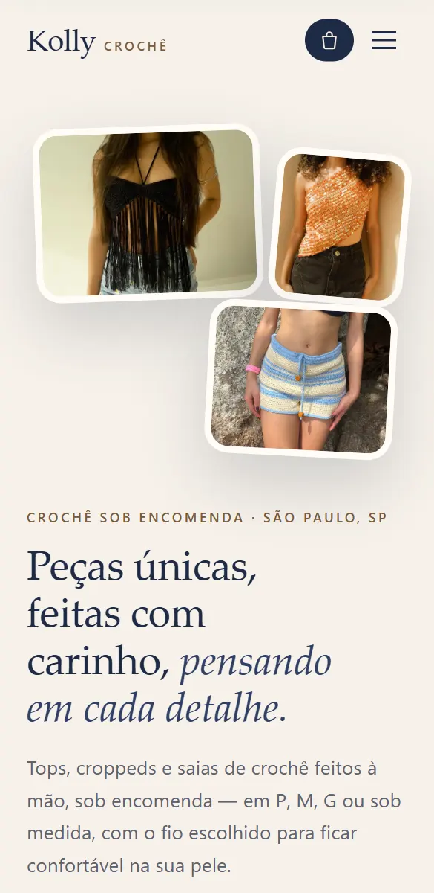
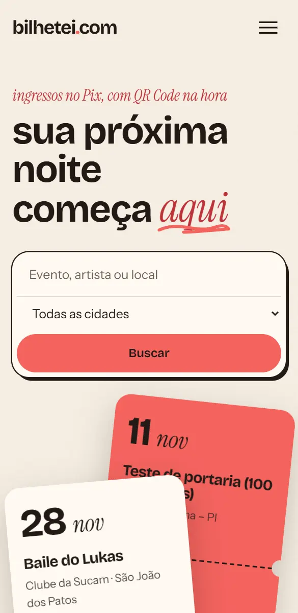
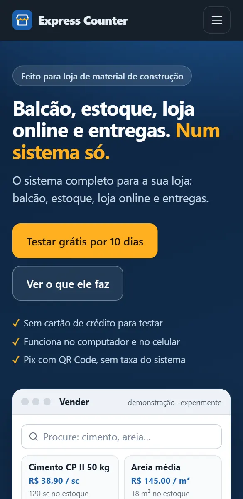

<p align="center">
  <a href="https://akapedr0.netlify.app"></a>
</p>

<h1 align="center">Pedro Jatobá</h1>

<p align="center">
  Desenvolvedor. Faço o produto inteiro: design, código, pagamento e publicação.
</p>

<p align="center">
  <a href="https://akapedr0.netlify.app"><b>akapedr0.netlify.app</b></a>
  &nbsp;·&nbsp;
  <a href="https://instagram.com/aka.pedr0">Instagram</a>
  &nbsp;·&nbsp;
  <a href="https://wa.me/5599984099638">WhatsApp</a>
  &nbsp;·&nbsp;
  <a href="mailto:phsousajatoba@gmail.com">E-mail</a>
</p>

## Projetos

Três produtos que criei do zero e que estão no ar.

<table>
  <tr>
    <td align="center" width="33%">
      <a href="https://kollycroche.netlify.app/"></a>
    </td>
    <td align="center" width="33%">
      <a href="https://bilhetei.com/"></a>
    </td>
    <td align="center" width="33%">
      <a href="https://expresscounter.com.br/"></a>
    </td>
  </tr>
  <tr>
    <td valign="top">
      <h3>Kolly Crochê</h3>
      <p><b>Loja sob encomenda.</b> Mostruário de peças de crochê feitas à mão. A cliente escolhe tamanho e cor, monta a sacola e o pedido chega pronto no WhatsApp.</p>
      <p><a href="https://kollycroche.netlify.app/">kollycroche.netlify.app</a></p>
    </td>
    <td valign="top">
      <h3>Bilhetei</h3>
      <p><b>Plataforma de ingressos.</b> Ingressos vendidos no Pix, com QR Code na hora. Quem organiza controla a portaria pelo celular e recebe direto na conta.</p>
      <p><a href="https://bilhetei.com/">bilhetei.com</a></p>
    </td>
    <td valign="top">
      <h3>Express Counter</h3>
      <p><b>Sistema para lojas de material de construção.</b> Balcão, estoque, loja online e entregas com rastreio em um sistema só. Emite nota fiscal e usa IA para simular a cor da parede.</p>
      <p><a href="https://expresscounter.com.br/">expresscounter.com.br</a></p>
    </td>
  </tr>
</table>

## Este repositório

É o código do meu portfólio, o site que fica no link da bio do Instagram.

<p align="center">
  <a href="https://akapedr0.netlify.app"></a>
</p>

- **Uma página só.** HTML e CSS puros em `index.html`, sem framework e sem etapa de build.
- **Pensado primeiro para celular**, porque quase todo mundo chega pelo Instagram.
- **Animações de scroll em CSS** (`animation-timeline`), com alternativa por `IntersectionObserver` nos navegadores que ainda não suportam. Quem usa "reduzir movimento" vê a página parada.
- **Fontes e imagens no próprio repositório**, em `assets/`, sem depender de CDN.

### Rodar localmente

```bash
python -m http.server 4173
```

Depois abra http://localhost:4173.

### Publicar

O site está hospedado no Netlify. Para republicar depois de um ajuste:

```bash
netlify deploy --prod --dir . --no-build
```

## Créditos

Ícones [Phosphor](https://phosphoricons.com) (MIT). Fontes [Anton](https://fonts.google.com/specimen/Anton) e [Bricolage Grotesque](https://fonts.google.com/specimen/Bricolage+Grotesque) (SIL Open Font License).
