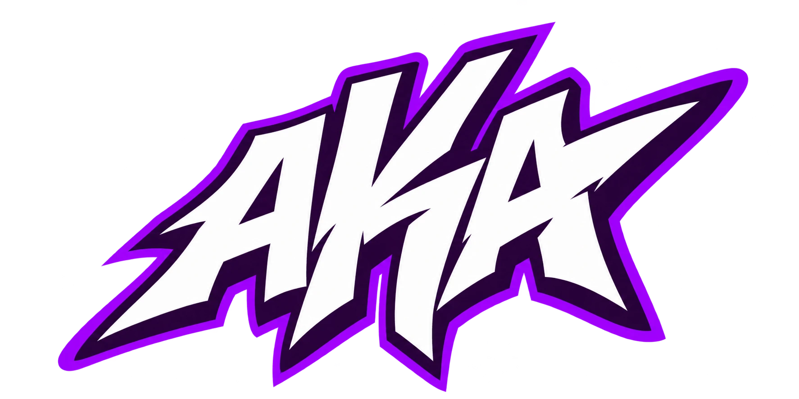
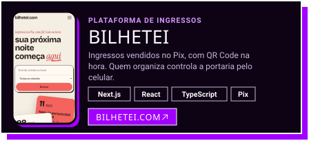
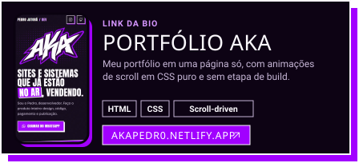

<table align="center" border="0" cellpadding="0" cellspacing="0">
  <tr>
    <td align="center" width="230">
      <a href="https://akapedr0.netlify.app"></a>
    </td>
    <td valign="middle" align="center" width="520">
      <h1>👋 Olá, eu sou o Pedro Jatobá</h1>
      <p><b><i>Desenvolvedor Full Stack • Next.js • React • Node.js • IA</i></b></p>
      <p>
        
      </p>
    </td>
  </tr>
</table>

<div align="center">
  <a href="https://akapedr0.netlify.app"></a>
  <a href="https://instagram.com/aka.pedr0"></a>
  <a href="https://wa.me/5599984099638"></a>
  <a href="mailto:phsousajatoba@gmail.com"></a>
</div>

## 🧑‍💻 Sobre mim

Desenvolvedor full stack. Crio o produto inteiro, do design ao deploy: sites, lojas online, plataformas com pagamento via Pix e sistemas de gestão. Trabalho principalmente com Next.js, React, TypeScript e Node.js, com PostgreSQL no banco e React Native no mobile. Três produtos meus estão no ar hoje.

<details open>
  <summary><h2>🚀 Projetos em destaque</h2></summary>

<div align="center">

<a href="https://kollycroche.netlify.app/"></a>
<a href="https://bilhetei.com/"></a>
<a href="https://expresscounter.com.br/"></a>
<a href="https://akapedr0.netlify.app"></a>

</div>
</details>

<details open>
  <summary><h2>🛠️ Tech Stack</h2></summary>

### Frontend e mobile

<p align="left">


</p>

### Backend e dados

<p align="left">


</p>

### Ferramentas e integrações

<p align="left">


</p>
</details>

<details>
  <summary><h2>📦 Este repositório</h2></summary>

É o código do meu portfólio, o site que fica no link da bio do Instagram: [akapedr0.netlify.app](https://akapedr0.netlify.app).

- **Uma página só.** HTML e CSS puros em `index.html`, sem framework e sem etapa de build.
- **Pensado primeiro para celular**, porque quase todo mundo chega pelo Instagram.
- **Animações de scroll em CSS** (`animation-timeline`), com alternativa por `IntersectionObserver` nos navegadores que ainda não suportam. Quem usa "reduzir movimento" vê a página parada.
- **Fontes e imagens no próprio repositório**, em `assets/`, sem depender de CDN.

Rodar localmente e abrir http://localhost:4173:

```bash
python -m http.server 4173
```

Republicar no Netlify depois de um ajuste:

```bash
netlify deploy --prod --dir . --no-build
```

Refazer os cards de projeto deste README depois de editar `.github/readme/cards.mjs`:

```bash
node .github/readme/cards.mjs
```

Ícones [Phosphor](https://phosphoricons.com) (MIT). Fontes [Anton](https://fonts.google.com/specimen/Anton) e [Bricolage Grotesque](https://fonts.google.com/specimen/Bricolage+Grotesque) (SIL Open Font License).

</details>

## 📫 Contato

<div align="center">

<a href="https://wa.me/5599984099638"></a>
<a href="https://instagram.com/aka.pedr0"></a>
<a href="mailto:phsousajatoba@gmail.com"></a>
<a href="https://akapedr0.netlify.app"></a>

⭐ Tem um projeto em mente? Me chama.

</div>
